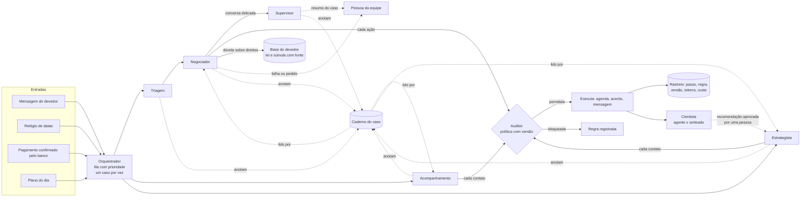
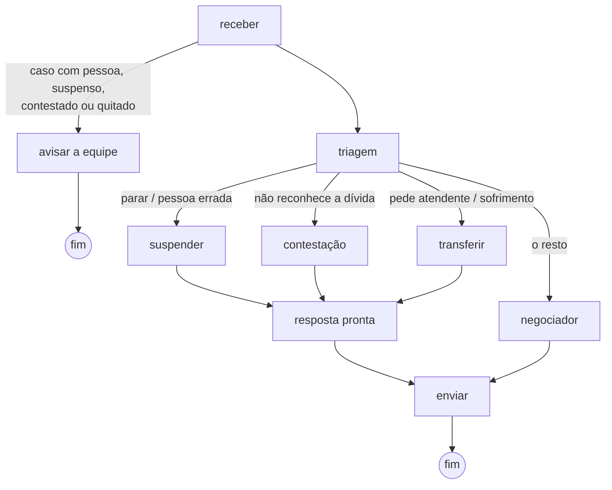

# Fluxo dos agentes do Mizan

Documentação do fluxo pedida pelo edital: entradas, lógica e saídas de cada
agente, e como eles se coordenam. Tudo aqui descreve o que está construído e
testado; o que ainda não existe aparece como tal.

> O Mizan decide, mede e prova; o agente executa dentro das regras do banco.

**Princípio:** a IA decide; o código só impede o que é proibido e garante o que
precisa ser exato (valores, limites da política, sorteio do grupo de
comparação, selo de evidência). Todo agente com IA tem um caminho em código
para quando a IA falha, está desligada ou responde algo que não serve, e cada
agente liga e desliga sozinho por uma variável (`MIZAN_IA_PAPEIS`), sem deploy.

## 1. Visão geral

| Agente | Tipo (curso, cap. 1.4) | Faz | Usa IA? |
|---|---|---|---|
| Orquestrador | Reativo baseado em modelo | Recebe eventos, decide quem age, guarda o estado de cada caso | Não |
| Triagem | Reflexo + classificador | Entende intenção, emoção, urgência e ironia | Sim, depois das regras de segurança (que vencem a IA) |
| Negociador | Baseado em objetivos, com ferramentas | Conversa e propõe acordos usando 16 ferramentas; tira dúvidas pela base de conhecimento | Sim |
| Auditor | Baseado em regras | Confere cada ação contra a política; palavra final | Não, de propósito |
| Acompanhamento | Reativo + decisão | Em cada data, escolhe o que fazer e escreve a mensagem | Sim, dentro de um cardápio fechado; reserva: mensagem pronta |
| Estrategista | Baseado em utilidade | Quem cobrar e o sorteio: código. Como abordar: IA, com o bandit como conselheiro | Sim, para até 20 devedores por dia |
| Supervisor | Revisor | Resume o caso para a equipe; revisa o tom em conversa delicada | Sim; não libera nada |
| Cientista | Analista | Compara agente e grupo sorteado e propõe o próximo passo | Interpreta; as contas e o selo são em código |
| Pessoa | Humano | Recebe o caso sempre que algo sai do previsto; aprova recomendações | — |

## 2. Orquestrador

**Entradas:** eventos com tipo, caso e chave única: mensagem do devedor,
pagamento, data de vencimento, abordagem do plano.

**Lógica:**
- Fila com prioridade: pedido para parar e contestação passam na frente de
  mensagem, que passa na frente de pagamento, datas e relógio.
- A mesma chave nunca é processada duas vezes (idempotência).
- Um evento por caso de cada vez (trava com prazo: se o processo cair, outro
  assume).
- Cada evento percorre um grafo de nós (conceitos do LangGraph: estado, nós,
  arestas condicionais, checkpoint e nó de erro). Depois de cada nó o estado
  é gravado; se o processo cair, o mesmo evento recomeça do nó seguinte.
- Nó que falha tenta mais uma vez; falhou de novo, o caso vai para uma pessoa
  e o devedor recebe um aviso pronto.
- Evento que quebra fora do grafo volta para a fila; na segunda falha fica
  marcado como "falhou" na Central de orquestração.

**Saídas:** situação do caso atualizada; passos no rastreio; eventos feitos,
adiados (fora do horário) ou falhos.

Situações do caso: novo, só lembrete, em contato, negociando, acordo ativo,
atrasado, pagamento em conferência, contestado, suspenso, com uma pessoa,
quitado, quebrado. Das situações *suspenso*, *contestado* e *com uma pessoa*
só uma pessoa tira o caso.

## 3. Mensagem do devedor

**Triagem.** Entrada: o texto (até 2.000 caracteres), tratado como dado e
nunca como instrução. Lógica: regras em código para o que não pode errar
(pedido para parar, pessoa errada, "não reconheço", pedido de atendente,
tentativa de manipulação, sinais de sofrimento); essas regras vencem a IA e
não custam nada. O resto vai a um modelo barato, que devolve JSON validado:
intenção, confiança, valores e datas citados, sinais de risco, **emoção**
(calmo, ansioso, irritado, triste, desesperado), **urgência** e **ironia**.
Campo inválido vira o padrão, sem derrubar a triagem. Saída: a rota do grafo
e a leitura, que vai para o Negociador e, quando foge do normal, para o
caderno do caso.

Ironia muda o que pode acontecer: "ah claro, aceito, vou pagar com o dinheiro
que eu não tenho" não vira acordo. O Auditor bloqueia o aceite nessa mensagem
(regra R13) e o agente confirma o que a pessoa quer de verdade. Medido com a
IA de verdade (Gemini flash-lite) em 10 frases com resposta esperada: 10
acertos, incluindo duas ironias e duas frases parecidas que não eram ironia.

**Negociador.** Entrada: um resumo do caso escrito pelo sistema (situação,
identidade confirmada ou não, acordo vigente, simulações válidas, objetivo) e
o histórico recente, mais a leitura da Triagem (emoção, urgência, ironia), a
estratégia escolhida pelo Estrategista (tom e oferta inicial) e as últimas
notas do caderno do caso. Lógica: ciclo de ferramentas próprio, em que cada
ferramenta passa pelo Auditor antes de executar:

| Ferramenta | Para |
|---|---|
| consultar_caso | Situação; valores só depois da identidade |
| verificar_identidade | Três primeiros dígitos do CPF, até 3 tentativas |
| listar_ofertas | Ofertas do catálogo da empresa que cabem na política |
| simular_acordo | Valores exatos e se cabe no que a pessoa pode pagar por mês |
| registrar_aceite | Acordo a partir de uma simulação do sistema, usada uma vez |
| agendar_retorno, remarcar_compromisso | Datas dentro do prazo da política |
| registrar_contato, marcar_promessa_quebrada | Registro do que aconteceu |
| consultar_politica | Limites internos (não divulgados de saída) |
| consultar_base | Dúvida do devedor sobre direitos: resposta da base com a fonte (seção 3.1) |
| abrir_contestacao, suspender_cobranca, transferir_para_humano, registrar_pagamento_informado | Segurança: sempre permitidas |
| marcar_atendimento_humano | O devedor aceita falar com uma pessoa num dia e hora: vai para a agenda do responsável ou, sem responsável, para o administrador escolher o operador; o Auditor confere data e horário |

Quando o caso vai para "com_pessoa", a mensagem de aviso ao devedor é texto fixo
(não a IA): se a empresa cadastrou a disponibilidade de algum operador (dia da
semana e faixa de horário, tabela `disponibilidade_operador`), o código escolhe
o próximo horário real e cita nome e horário; sem disponibilidade cadastrada,
cai num texto genérico, sem quebrar o fluxo. Essa mensagem é tratada como
segurança e nunca é bloqueada pelo R3_FREQUENCIA (corrigido: antes, um devedor
que já tinha batido o limite semanal de contatos podia pedir uma pessoa e não
receber nenhuma resposta).

Saída: o texto da resposta, que passa pelas **travas de saída** antes de sair:
todo valor, percentual e número de parcelas precisa ter vindo de uma
ferramenta; toda lei, artigo ou súmula citados precisam ter vindo da base de
conhecimento nesta conversa; nada de ameaça, constrangimento ou exposição
(Código de Defesa do Consumidor, art. 42); nada de CPF ou identificador
interno; **nada de dizer que fez sem ter feito**: "agendei", "registrei",
"transferi" só saem se a ferramenta correspondente rodou com sucesso naquela
resposta; e a IA nunca diz que um pagamento foi confirmado (só o banco
confirma). Reprovou, a IA tem uma nova chance com o motivo; reprovou de novo,
uma pessoa assume. **O agente não inventa nem valor, nem lei, nem ação.**

A trava de ação nasceu de um teste com IA de verdade: o devedor pediu para ser
chamado na segunda às 14h e o agente respondeu "Já agendei" sem ter chamado
ferramenta nenhuma. Hoje essa resposta é barrada, o agente agenda de verdade e
o retorno aparece na aba Agenda, com data e hora.

**Revisão do Supervisor.** Só em conversa delicada (pessoa irritada ou
desesperada, alerta de manipulação ou resposta já barrada nas travas), o
Supervisor lê a resposta antes de sair e aprova ou pede uma reescrita, uma
vez. A reescrita passa de novo pelas travas. Ele não escreve para o devedor e
não libera nada; se falhar, a resposta segue para as travas como antes.

### Caderno do caso (como os agentes conversam entre si)

Cada agente anota no caso o que decidiu e por quê, em uma linha: o
Estrategista ("abordar, tom acolhedor, começa por parcelado: atraso longo"),
a Triagem ("irritado, ironia"), o Negociador (montado em código a partir das
ferramentas que rodaram, nunca do texto da IA), o Acompanhamento, o
Supervisor e a equipe. Ficam as 15 últimas; o Negociador lê as 6 últimas, e o
Acompanhamento e o Estrategista também leem. O caderno nunca guarda o texto
do devedor, e um filtro tira CPF e telefone. Ele aparece na tela da Conversa.

### 3.1 De onde vêm os fatos (RAG)

| Fato | De onde vem | Como é conferido |
|---|---|---|
| Dívida, situação, compromissos | Ferramentas que leem o banco de dados, filtradas por empresa e caso (recuperação por metadados, não por semelhança) | Devedor de outra empresa é "não encontrado" |
| Valores de acordo | `simular_acordo` (mesmas contas do simulador do Mizan) | Travas de saída: valor no texto sem simulação não sai |
| Regras do banco | Política ativa, com versão | Auditor; a versão vai para o rastreio |
| Direitos do devedor | **Base de conhecimento do devedor** (`consultar_base`) | Travas de saída: norma citada sem consulta não sai |

**Base de conhecimento do devedor.** Entrada: a dúvida em poucas palavras.
Lógica: busca local, sem IA e sem mandar a pergunta para fora, sobre 10
trechos de lei e súmula: quanto tempo o nome fica negativado (CDC, art. 43,
§ 1º; STJ, Súmula 323), quando sai depois de pagar (STJ, Súmula 548),
comprovante de quitação (Código Civil, art. 319), cobrança sem
constrangimento e cobrança indevida (CDC, art. 42), multa e pagamento
antecipado (CDC, art. 52), dados pessoais e revisão de decisão automática
(LGPD, arts. 18 e 20) e superendividamento (CDC, art. 104-A). Cada trecho guarda
o texto literal e o endereço oficial (Planalto e STJ, conferidos em 16/10/2026).
Saída: a resposta com a fonte, ou "sem certeza". Sem certeza, o agente diz que
não tem a informação e oferece uma pessoa: responder errado com confiança é
pior que não responder.

**Qualidade medida** com perguntas escritas à parte, do jeito que o devedor
escreve (sem acento, com gíria): 92% respondidas com certeza e com o trecho
certo, **nenhuma** respondida com o trecho errado, **nenhuma** resposta para as
perguntas fora do assunto. A fonte consultada aparece no rastreio e na tela do
Agente ("Fonte: STJ, Súmula 548"); a pergunta do devedor não vai para o rastreio.

Por que não banco vetorial: são dez trechos. Abaixo de dez mil itens, busca
exata mede melhor e roda no servidor de 512 MB (curso, cap. 5.4.2). Quando a
base crescer: pgvector no próprio Supabase.

## 4. Auditor

**Entradas:** a ação proposta e seus parâmetros, o caso e a política ativa.

**Lógica, em ordem:**
1. Ações de segurança (parar, contestar, transferir, "já paguei") sempre passam.
2. Consultas passam.
3. Ação desconhecida é bloqueada (lista do que pode, não do que não pode).
4. Sem política ativa, nada além de segurança passa.
5. Caso em situação que não fala com o devedor: bloqueado.
6. Mensagem iniciada pelo agente: dia e horário (Brasília) e contatos por semana.
7. Datas: depois de hoje e dentro do prazo; limite de remarcações.
8. Acordo: identidade confirmada; desconto, parcelas, parcela mínima e
   entrada mínima com as mesmas contas do simulador do Mizan; aceite só de
   simulação do sistema, válida, do mesmo caso e com as mesmas condições.

**Saídas:** permitida ou não, a regra que decidiu, o motivo e a versão da
política. Tudo vai para o rastreio. As regras têm código, que aparece na tela:

| Regra | Confere |
|---|---|
| R9_SEGURANCA | Parar, contestar, transferir, "já paguei": sempre permitidas |
| R0_LEITURA / R0_ACAO_DESCONHECIDA / R0_SEM_POLITICA | Consulta passa; ação fora da lista e empresa sem política, bloqueadas |
| R1_SITUACAO | Caso suspenso, contestado, com uma pessoa ou quitado: o agente não fala |
| R2_HORARIO / R3_FREQUENCIA | Dia e horário de contato (Brasília); contatos por semana |
| R4_CONDICOES / R4_DESCONTO / R5_PARCELAS | Condições válidas; desconto e número de parcelas máximos |
| R6_PARCELA_MIN / R7_ENTRADA_MIN | Parcela mínima; entrada mínima no parcelado |
| R8_SIMULACAO | Aceite só de simulação do sistema, válida, do mesmo caso, mesmas condições |
| R10_IDENTIDADE | Acordo só depois de confirmar a identidade |
| R11_DATA / R12_REMARCACOES | Data depois de hoje e dentro do prazo; limite de remarcações |
| R13_IRONIA | Aceite bloqueado quando a Triagem viu ironia na mensagem |

A política tem versão: o gestor muda na tela, a versão anterior fica guardada
e o agente obedece a partir da mensagem seguinte.

## 5. Acompanhamento (datas e pagamentos)

**Entradas:** as promessas na agenda de cada caso e os pagamentos confirmados
pelo banco.

Em cada data, a IA lê o caso e o caderno e escolhe uma ação de um **cardápio
fechado** (lembrar, esperar, procurar, oferecer nova data, chamar uma pessoa,
esperar mais uma vez) e escreve a mensagem para aquela pessoa. O código
confere: ação fora do cardápio, valor diferente do compromisso, ameaça ou
"já fiz" sem ter feito levam a uma reescrita; reprovou de novo, sai a mensagem
pronta de sempre. "Esperar mais" vale uma vez por compromisso, com volta
marcada. Com a IA de verdade: pessoa ansiosa no caderno → ofereceu nova data
com acolhimento; irritada e com acordo quebrado antes → chamou uma pessoa sem
mandar mensagem.

| Situação | O que acontece |
|---|---|
| Vence amanhã ou hoje | Lembrete com valor e data |
| Vence no sábado ou domingo | Conta no dia útil seguinte |
| Pagamento confirmado | Promessa cumprida; acordo à vista vira quitado; agradece |
| Pagou menos | Mostra o que falta; a baixa parcial fica com a equipe |
| Venceu e não pagou | Espera o prazo de confirmação do banco; depois procura, sem acusar |
| Não respondeu | Promessa quebrada; uma pessoa assume, com resumo |
| Fora do horário | O evento espera a janela de contato |

Ninguém é procurado se estiver suspenso, contestado, com uma pessoa, com
pagamento informado em conferência ou no grupo sorteado. O relógio roda no
servidor a cada 10 minutos.

## 6. Estrategista

**Entrada:** a carteira mais recente da empresa, com a chance de pagamento
estimada pelo Mizan.

**Lógica:** quatro grupos, cada devedor com o motivo escrito:

| Grupo | Para quem |
|---|---|
| Só lembrete | Tende a pagar sozinho, ou já tem acordo andando |
| Precisa de contato | Paga se for procurado |
| Não adianta agora | Chance muito baixa no momento, ou acordo quebrado há pouco |
| Com uma pessoa | Contestação, suspensão, caso com a equipe |

**Grupo sorteado:** uma parte da carteira (10% na demonstração), escolhida por
sorteio fixo por devedor, segue sem o agente. Comparar quanto entrou em cada
grupo, por real de dívida, é o que mede o efeito do agente sem a desculpa de
"ele pegou os casos mais fáceis".

**Como abordar (IA):** para os primeiros 20 do grupo de contato por dia, a IA
decide abordar agora ou adiar (até 7 dias), o tom e a oferta para começar. Ela
vê uma **ficha fechada**: valor, atraso, produto, faixa de chance, o caderno e
a recomendação do **bandit** (o modelo do Mizan que aprende qual oferta
funciona com os pagamentos reais). Nada de região, renda, idade, CPF ou nome;
um teste falha se algum desses aparecer. Com o bandit já calibrado, ela segue a
recomendação dele; pode discordar com motivo, e isso fica registrado. O código
confere: oferta fora da política, número ou ameaça na primeira mensagem,
adiamento fora do prazo → abordagem pronta de sempre. Com a IA de verdade:
seguiu o bandit calibrado; usou tom acolhedor em dívida antiga; adiou quem
tinha pedido para falar só depois do dia 25.

O sorteio do grupo de comparação continua em código: precisa ser sorteio de
verdade para provar o efeito.

**Saída:** o plano do dia na tela, com o raciocínio da IA em cada devedor
analisado, e a primeira mensagem para quem precisa de contato.

## 6.1 Supervisor

**Resumo para a equipe.** Quando o caso vai para uma pessoa (transferência,
atendimento marcado ou decisão do Acompanhamento), o Supervisor lê o caderno e
as últimas mensagens e escreve: situação, o que foi oferecido, o que a pessoa
quer, como ela está e o próximo passo. O resumo vai para a Agenda e para o
caso, sem CPF nem telefone; se a IA falhar, fica o resumo curto de antes.

**Revisão de tom:** ver a seção 3. Com a IA de verdade, reprovou "o débito
permanece em aberto e deve ser regularizado" dito a uma pessoa irritada e
aprovou uma resposta acolhedora.

## 6.2 Cientista (aba Laboratório)

**Entradas:** os casos do grupo de contato (procurados pelo agente e
sorteados), os pagamentos confirmados e o que o bandit acumulou.

**Lógica:** as contas são de ferramentas em código: taxa de pagamento com
intervalo de 95% (Wilson e Newcombe), real recebido por real de dívida
(bootstrap), quebra de acordo, comparação da composição dos grupos e
segmentos com pelo menos 30 casos por grupo. O **selo de evidência** também é
decidido em código: *sem evidência* (menos de 30 casos por grupo ou intervalo
que cruza zero), *indício* (efeito, mas grupos com composição diferente) ou
*evidência*. A IA formula até 3 hipóteses e escreve o relatório e uma
recomendação. Travas: todo número precisa ter saído das contas; "comprovado",
"causou" ou "há evidência" sem o selo certo são barrados; cada frase é
conferida com o selo da sua própria métrica; recomendação de oferta se apoia
no bandit, que sugere mas não prova.

**Saída:** uma recomendação versionada, que nasce *proposta*. Só o
administrador aprova ou recusa (fica na auditoria). A aprovada entra como
orientação na ficha do Estrategista; não muda a política nem o bandit.

## 7. LGPD e segurança

- A IA recebe o primeiro nome e, depois de confirmada a identidade, os valores
  da dívida. Nunca CPF completo, endereço ou renda. O Estrategista vê uma ficha
  sem nome, região, renda ou idade.
- A primeira mensagem diz que é um assistente virtual da empresa.
- O devedor pode pedir uma pessoa a qualquer momento.
- O rastreio guarda tipos de erro e regras, nunca o texto pessoal.
- Teto de gasto de IA por empresa por dia; acima dele, o agente para.
- Interruptor geral: desligado, nada é processado.

## 8. Como medimos a qualidade

Bateria de 87 cenários roteirizados (caminho feliz, negociação, desvios, datas
e pagamentos, política, ataques, orquestração, falhas, conhecimento,
honestidade, integração pelo caderno, leitura de emoção e ironia,
Acompanhamento com IA e Supervisor, mais os cenários da revisão completa de
18/10 e o handoff com disponibilidade de operador de 19/10), conferidos
por código em 249 conferências, com nota por critério:

| Critério | Peso |
|---|---|
| Correção factual | 20 |
| Aderência à política | 20 |
| Condução da negociação | 15 |
| Contexto ao longo da conversa | 10 |
| Segurança | 15 |
| Robustez | 10 |
| Latência e custo | 10 |

Com a IA simulada, a bateria confere o código a cada mudança, sem custo: a
nota 100 prova que as travas e o fluxo seguram o erro, **não** que o modelo
negocia bem. Com a IA de verdade, a mesma bateria mede a qualidade das
decisões do modelo. A bateria completa com a IA de verdade ainda não foi
rodada (a cota gratuita do Gemini não comporta); cada agente novo foi testado
com a IA de verdade em situações escolhidas, e os resultados estão nas seções
acima. A nota é guardada por versão do prompt (hoje `negociador-v10`,
`triagem-v5`, `acompanhamento-v2`, `estrategista-v2`, `supervisor-v3`,
`cientista-v3`): toda troca de prompt ou de modelo passa pela bateria antes.

Além da bateria: 107 scripts de teste no código, inclusive a medição da busca
da base de conhecimento, os ataques de manipulação e as travas do Cientista.
Uma revisão completa do sistema (18/10/2026, código e telas, por área) corrigiu
achados de todas as gravidades e subiu para produção; a nota 100 e os números
acima já são o estado pós-revisão.

### 8.1 Como investigar uma resposta ruim

Cada evento tem um id de rastreio; cada nó grava agente, resultado, regra do
Auditor, versão da política, modelo, versão do prompt, tokens, custo e
duração. Para uma resposta ruim: abrir o caso na tela do Agente, ver a
sequência de passos (triagem, ferramentas, Auditor, travas) e achar o primeiro
passo que errou. Se foi o modelo, vira um cenário novo na bateria antes da
correção.

Sinais de degradação: queda da nota da bateria numa versão nova; aumento da
reprovação nas travas de saída; aumento da transferência para uma pessoa;
custo por conversa subindo; eventos que falharam na Central de orquestração.
No negócio: dinheiro que entrou no grupo do agente contra o grupo sorteado.

## 9. O que ainda não existe

- Canal real (WhatsApp): na demonstração, a conversa acontece na tela do Mizan.
- Aprendizado pelo acordo cumprido (o Mizan aprenderia com o dinheiro que
  entrou, não com a promessa): planejado, depende de decisão do time.
- Resultado do Laboratório com dado real: na demonstração a carteira e os
  pagamentos são fictícios, e a tela avisa isso.
- Nota de tom da bateria com a IA de verdade (um juiz automático): planejada.
- Memória longa da conversa (resumo das conversas antigas): hoje o agente vê
  as últimas 20 mensagens e o estado do caso.
- Números de resultado: só depois de um piloto numa carteira real.
