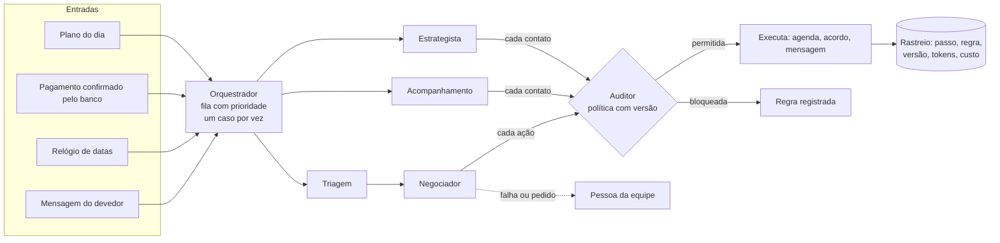
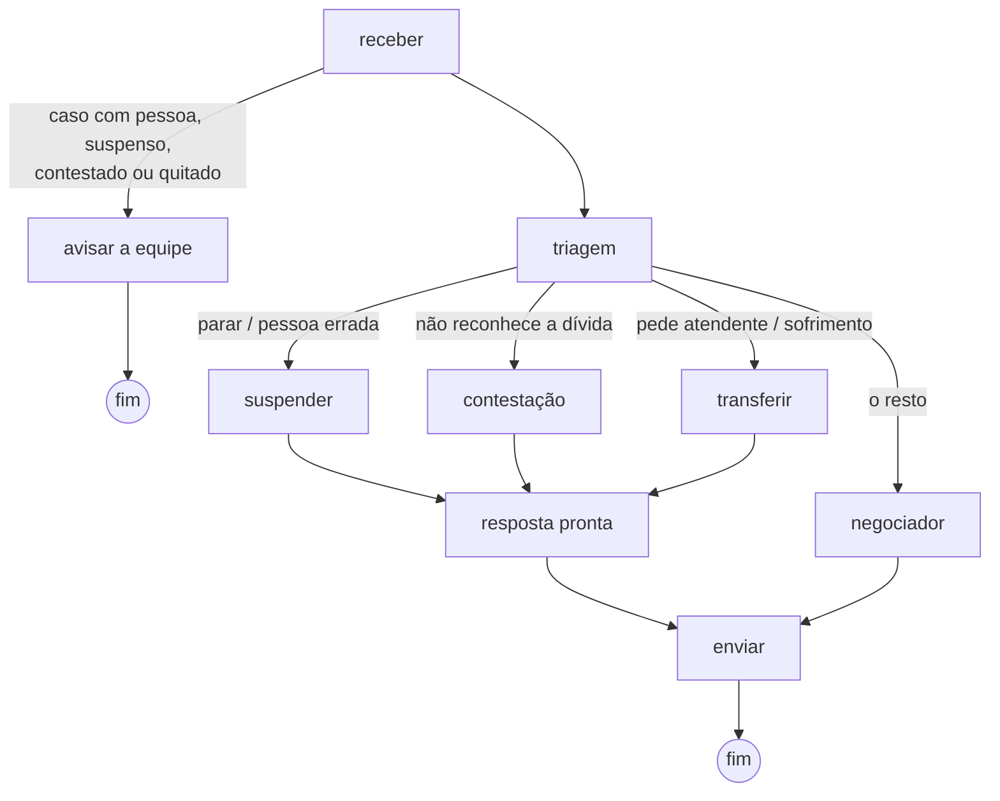

# Fluxo dos agentes do Mizan

Documentação do fluxo pedida pelo edital: entradas, lógica e saídas de cada
agente, e como eles se coordenam. Tudo aqui descreve o que está construído e
testado; o que ainda não existe aparece como tal.

> O Mizan decide, mede e prova; o agente executa dentro das regras do banco.

## 1. Visão geral

| Agente | Tipo (curso, cap. 1.4) | Faz | Usa IA? |
|---|---|---|---|
| Orquestrador | Reativo baseado em modelo | Recebe eventos, decide quem age, guarda o estado de cada caso | Não |
| Triagem | Reflexo + classificador | Entende a intenção da mensagem | Só para o que as regras não decidem (modelo barato) |
| Negociador | Baseado em objetivos, com ferramentas | Conversa e propõe acordos usando 14 ferramentas | Sim |
| Auditor | Baseado em regras | Confere cada ação contra a política; palavra final | Não |
| Acompanhamento | Reativo | Lembretes, atrasos, pagamentos | Não (mensagens prontas) |
| Estrategista | Baseado em utilidade | Divide a carteira em grupos e sorteia o grupo de controle | Não |
| Pessoa | Humano | Recebe o caso sempre que algo sai do previsto | — |

## 2. Orquestrador

**Entradas:** eventos com tipo, caso e chave única: mensagem do devedor,
pagamento, data de vencimento, abordagem do plano.

**Lógica:**
- Fila com prioridade: pedido para parar e contestação passam na frente de
  mensagem, que passa na frente de pagamento, datas e relógio.
- A mesma chave nunca é processada duas vezes (idempotência).
- Um evento por caso de cada vez (trava com prazo: se o processo cair, outro
  assume).
- Cada evento percorre um grafo de nós (conceitos do LangGraph: estado, nós,
  arestas condicionais, checkpoint e nó de erro). Depois de cada nó o estado
  é gravado; se o processo cair, o mesmo evento recomeça do nó seguinte.
- Nó que falha tenta mais uma vez; falhou de novo, o caso vai para uma pessoa
  e o devedor recebe um aviso pronto.
- Evento que quebra fora do grafo volta para a fila; na segunda falha fica
  marcado como "falhou" na Central de orquestração.

**Saídas:** situação do caso atualizada; passos no rastreio; eventos feitos,
adiados (fora do horário) ou falhos.

Situações do caso: novo, só lembrete, em contato, negociando, acordo ativo,
atrasado, pagamento em conferência, contestado, suspenso, com uma pessoa,
quitado, quebrado. Das situações *suspenso*, *contestado* e *com uma pessoa*
só uma pessoa tira o caso.

## 3. Mensagem do devedor

**Triagem.** Entrada: o texto (até 2.000 caracteres), tratado como dado e
nunca como instrução. Lógica: regras em código para o que não pode errar
(pedido para parar, pessoa errada, "não reconheço", pedido de atendente,
tentativa de manipulação, sinais de sofrimento); essas regras vencem a IA e
não custam nada. O resto vai a um modelo barato, que devolve JSON validado:
intenção, confiança, valores e datas citados, sinais de risco. Saída: a rota
do grafo.

**Negociador.** Entrada: um resumo do caso escrito pelo sistema (situação,
identidade confirmada ou não, acordo vigente, simulações válidas, objetivo) e
o histórico recente. Lógica: ciclo de ferramentas próprio, em que cada
ferramenta passa pelo Auditor antes de executar:

| Ferramenta | Para |
|---|---|
| consultar_caso | Situação; valores só depois da identidade |
| verificar_identidade | Três primeiros dígitos do CPF, até 3 tentativas |
| listar_ofertas | Ofertas do catálogo da empresa que cabem na política |
| simular_acordo | Valores exatos e se cabe no que a pessoa pode pagar por mês |
| registrar_aceite | Acordo a partir de uma simulação do sistema, usada uma vez |
| agendar_retorno, remarcar_compromisso | Datas dentro do prazo da política |
| registrar_contato, marcar_promessa_quebrada | Registro do que aconteceu |
| consultar_politica | Limites internos (não divulgados de saída) |
| abrir_contestacao, suspender_cobranca, transferir_para_humano, registrar_pagamento_informado | Segurança: sempre permitidas |

Saída: o texto da resposta, que passa pelas **travas de saída** antes de sair:
todo valor, percentual e número de parcelas precisa ter vindo de uma
ferramenta; nada de ameaça, constrangimento ou exposição (Código de Defesa do
Consumidor, art. 42); nada de CPF ou identificador interno. Reprovou, a IA
tem uma nova chance com o motivo; reprovou de novo, uma pessoa assume.

## 4. Auditor

**Entradas:** a ação proposta e seus parâmetros, o caso e a política ativa.

**Lógica, em ordem:**
1. Ações de segurança (parar, contestar, transferir, "já paguei") sempre passam.
2. Consultas passam.
3. Ação desconhecida é bloqueada (lista do que pode, não do que não pode).
4. Sem política ativa, nada além de segurança passa.
5. Caso em situação que não fala com o devedor: bloqueado.
6. Mensagem iniciada pelo agente: dia e horário (Brasília) e contatos por semana.
7. Datas: depois de hoje e dentro do prazo; limite de remarcações.
8. Acordo: identidade confirmada; desconto, parcelas, parcela mínima e
   entrada mínima com as mesmas contas do simulador do Mizan; aceite só de
   simulação do sistema, válida, do mesmo caso e com as mesmas condições.

**Saídas:** permitida ou não, a regra que decidiu, o motivo e a versão da
política. Tudo vai para o rastreio.

A política tem versão: o gestor muda na tela, a versão anterior fica guardada
e o agente obedece a partir da mensagem seguinte.

## 5. Acompanhamento (datas e pagamentos)

**Entradas:** as promessas na agenda de cada caso e os pagamentos confirmados
pelo banco.

| Situação | O que acontece |
|---|---|
| Vence amanhã ou hoje | Lembrete com valor e data (mensagem pronta) |
| Vence no sábado ou domingo | Conta no dia útil seguinte |
| Pagamento confirmado | Promessa cumprida; acordo à vista vira quitado; agradece |
| Pagou menos | Mostra o que falta; a baixa parcial fica com a equipe |
| Venceu e não pagou | Espera o prazo de confirmação do banco; depois procura, sem acusar |
| Não respondeu | Promessa quebrada; uma pessoa assume, com resumo |
| Fora do horário | O evento espera a janela de contato |

Ninguém é procurado se estiver suspenso, contestado, com uma pessoa, com
pagamento informado em conferência ou no grupo sorteado. O relógio roda no
servidor a cada 10 minutos.

## 6. Estrategista

**Entrada:** a carteira mais recente da empresa, com a chance de pagamento
estimada pelo Mizan.

**Lógica:** quatro grupos, cada devedor com o motivo escrito:

| Grupo | Para quem |
|---|---|
| Só lembrete | Tende a pagar sozinho, ou já tem acordo andando |
| Precisa de contato | Paga se for procurado |
| Não adianta agora | Chance muito baixa no momento, ou acordo quebrado há pouco |
| Com uma pessoa | Contestação, suspensão, caso com a equipe |

**Grupo sorteado:** uma parte da carteira (10% na demonstração), escolhida por
sorteio fixo por devedor, segue sem o agente. Comparar quanto entrou em cada
grupo, por real de dívida, é o que mede o efeito do agente sem a desculpa de
"ele pegou os casos mais fáceis".

**Saída:** o plano do dia na tela e, ao aplicar, a primeira mensagem (pronta)
para quem precisa de contato.

## 7. LGPD e segurança

- A IA recebe o primeiro nome e, depois de confirmada a identidade, os valores
  da dívida. Nunca CPF completo, endereço ou renda.
- A primeira mensagem diz que é um assistente virtual da empresa.
- O devedor pode pedir uma pessoa a qualquer momento.
- O rastreio guarda tipos de erro e regras, nunca o texto pessoal.
- Teto de gasto de IA por empresa por dia; acima dele, o agente para.
- Interruptor geral: desligado, nada é processado.

## 8. Como medimos a qualidade

Bateria de 63 cenários roteirizados (caminho feliz, negociação, desvios, datas
e pagamentos, política, ataques, orquestração e falhas), conferidos por código
em 181 conferências, com nota por critério:

| Critério | Peso |
|---|---|
| Correção factual | 20 |
| Aderência à política | 20 |
| Condução da negociação | 15 |
| Contexto ao longo da conversa | 10 |
| Segurança | 15 |
| Robustez | 10 |
| Latência e custo | 10 |

Com a IA simulada, a bateria confere o código a cada mudança, sem custo. Com a
IA de verdade, mede a qualidade das decisões do modelo. A nota com a IA de
verdade ainda não foi medida.

## 9. O que ainda não existe

- Conversa com a IA de verdade (a integração está pronta; falta a chave).
- Canal real (WhatsApp): na demonstração, a conversa acontece na tela do Mizan.
- Aprendizado pelo acordo cumprido (o Mizan aprenderia com o dinheiro que
  entrou, não com a promessa): planejado, depende de decisão do time.
- Números de resultado: só depois de um piloto numa carteira real.
